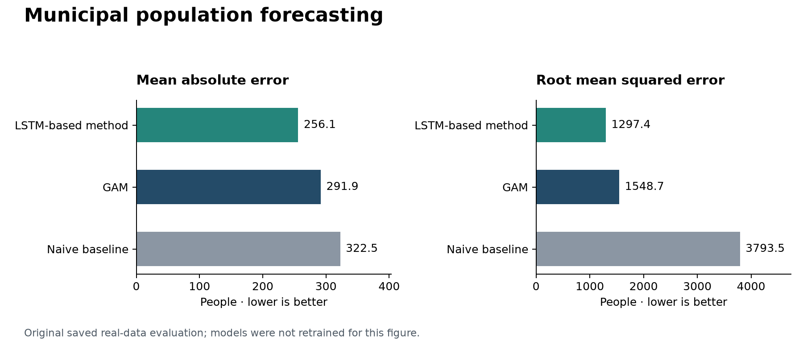

# Municipal population forecasting and healthcare accessibility

**Forecast municipal population to 2040, quantify prediction uncertainty, and
explore how demographic change affects territorial healthcare accessibility.**

Group coursework for Nonparametric Statistics at Politecnico di Milano, developed
by [aleambrogi](https://github.com/aleambrogi) and
[dragonslayerere](https://github.com/dragonslayerere). Both contributors worked
across the project. This is an academic analysis, with saved experimental results.

## Project at a glance

| Component | Work included |
| --- | --- |
| Data preparation | Historical municipal population series, geographic identifiers and spatial inputs |
| Forecasting | Python/PyTorch LSTM models with province and region embeddings |
| Uncertainty | Ensemble residuals, quantile modelling and adaptive interval calibration |
| Evaluation | Naive, kernel ridge and GAM comparisons; MAE, RMSE, coverage and interval width |
| Territorial analysis | R scripts for accessibility indicators, population maps and functional summaries |



The figure uses **saved real-data notebook outputs**, not newly retrained models.
The reported LSTM-based method has lower point error than the naive baseline in
that saved evaluation, but its interval coverage is below the configured nominal
level. See [results and limitations](reports/RESULTS.md).

## Start here

1. **Review results without training:** read [results and limitations](reports/RESULTS.md)
   and the figures. Run the lightweight preview below to inspect the included CSVs.
2. **Inspect the real-data analysis:** open
   [02_real_population_forecasting.ipynb](notebooks/02_real_population_forecasting.ipynb).
3. **Understand the method on simulated data:** open
   [01_synthetic_population_forecasting.ipynb](notebooks/01_synthetic_population_forecasting.ipynb).
4. **Explore the R analysis:** see [R scripts and external inputs](scripts/r/README.md).

## Setup

Use Python 3.12 and an isolated environment. From the repository root:

```bash
python -m venv .venv
```

Activate it with `.venv\Scripts\Activate.ps1` in Windows PowerShell or
`source .venv/bin/activate` on macOS/Linux, then install:

```bash
python -m pip install -r requirements.txt
python scripts/preview_results.py
python -m unittest discover -s tests -v
jupyter lab
```

For preview only, `python -m pip install -r requirements-preview.txt` is sufficient.
The notebooks retain their original saved outputs. Running all cells retrains
multiple neural networks and may be slow on CPU; there is no full-training runtime
claim. New notebook exports go to `results/runs/`, keeping the original saved
prediction CSV separate.

## Repository layout

```text
notebooks/          Synthetic demo and real municipal analysis
data/processed/     Historical population CSV used by the real notebook
data/external/      Location for optional external R-analysis inputs
results/            Original saved population forecasts
reports/            Evaluation notes, figures and data-quality report
scripts/            Lightweight preview and supplementary R scripts
tests/              Schema, notebook and model smoke checks
```

## Scope and data

The included historical CSV contains annual municipal population records for
1982-2024. The saved forecast file covers 2025-2040. The broader healthcare
scenario holds healthcare infrastructure fixed while changing population.
These are scenario projections, not official demographic forecasts or validated
investment recommendations. See [data provenance and coverage](data/README.md).

The optional R workflow needs additional population extracts, hospital inputs and
geographic boundaries that are not all included. It is documented separately and
is not claimed to run from the bundled CSVs alone.

## Contributors

- [aleambrogi](https://github.com/aleambrogi)
- [dragonslayerere](https://github.com/dragonslayerere)

Original results remain attributable to the joint coursework. See
[portfolio changes](CHANGELOG.md) for the packaging changes and validation scope.
